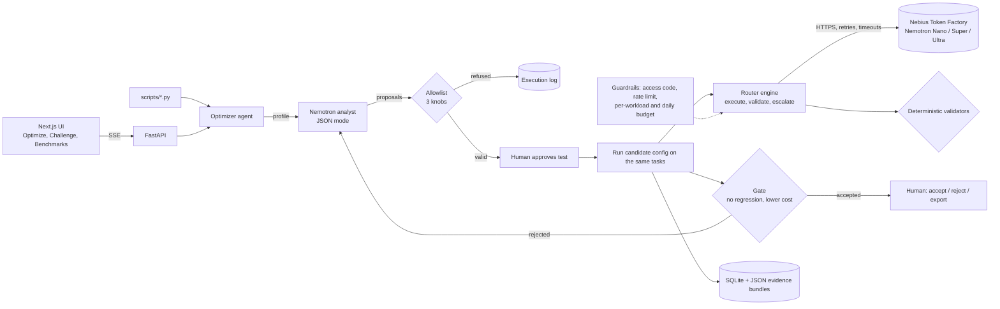

# EcoCompute AI

**An evidence-driven optimization agent that treats wasted AI computation as a fixable software-engineering problem.**

EcoCompute measures a recurring AI workload, has **NVIDIA Nemotron (via Nebius Token Factory)** diagnose where compute is wasted and propose bounded changes, runs those changes on the same tasks, and keeps only what independent validators and measurements confirm. A human accepts, rejects or exports the result. Nothing is applied automatically.

> Coding & Agentic Engineering track · MIT license · [Engineering audit](docs/AUDIT.md) · [Results](docs/RESULTS.md) · [Methodology](docs/methodology.md)

<!-- TODO before submission: hosted demo URL and YouTube link. -->
- **Live demo:** _TBD_
- **Demo video (< 3 min):** _TBD_

**Who it is for:** ML engineers and small AI teams that run the same LLM jobs every day (ticket triage, extraction, ETL enrichment, eval suites) and send all of it to their biggest model because they cannot tell which tasks a smaller one would get right.

## The loop

```
observe ─► reason ─► propose ─► approve ─► execute ─► measure ─► verify ─► (refine) ─► decide
baseline   Nemotron   JSON,     human      same       tokens,    determin-  regressions  human:
run        reads the  allow-    picks what tasks,     cost,      istic      go back to   accept /
           measured   listed    may be     candidate  latency,   gate,      Nemotron,    reject /
           profile    knobs     tested     config     CPU, est.  no LLM     ≤3 rounds    export
                                                       energy
```

| Step | Implementation | File |
| --- | --- | --- |
| Observe | Runs every task of the workload on the current configuration (largest Nemotron, no escalation) and profiles it per category: pass rate, output and reasoning tokens, truncations, latency, cost. | `backend/app/optimizer.py` `run_baseline`, `build_profile` |
| Reason + propose | One Nemotron call (default Nemotron Super) in JSON mode. It returns a diagnosis citing the measured numbers, plus proposals. If JSON mode is unsupported it retries once with plain JSON prompting; malformed or off-schema output is reported, never guessed. | `call_analyst`, `ANALYST_SCHEMA` |
| Constrain | Each proposal is checked against an **allowlist of three knobs**: `route_category` (which tier answers), `cap_output_tokens`, `enable_escalation`. Unknown actions, tiers, categories or values are refused **before anything runs**. The agent cannot execute code or commands and cannot edit the live router. | `validate_proposal` |
| Approve | A human selects which valid proposals may be tested (testing spends real calls). | `/optimize` step 4 |
| Execute + measure | The candidate configuration runs on the same tasks at temperature 0. Every call records provider-reported tokens, latency, cost and request ID; the backend's CPU time and a FLOPs-based energy estimate are added. | `execute` |
| Verify | A deterministic gate, independent of any model: same tasks, no provider errors, **no task that passed on the baseline may fail**, pass count preserved, cost (or tokens) strictly lower. Task quality itself is checked by deterministic validators (JSON Schema, exact fields, labels, numeric tolerance, sandboxed unit tests). | `gate` |
| Refine | If the gate rejects, the regressions and gate results go back to Nemotron, which revises its proposals. Bounded to 1–3 rounds. | `verify` |
| Safety drill | EcoCompute injects two labelled bad proposals: an `execute_command` that must be refused by the allowlist, and a 16-token output cap that passes the schema but must be rejected by measurement. | `drill_proposals` |
| Decide | A verified recommendation waits for a human to accept, reject or export it (JSON config plus the full evidence bundle). | `decide`, `export` |

## What is new here

| Compared with | They | EcoCompute |
| --- | --- | --- |
| Profilers and monitoring dashboards | show where time and money go | acts on it: proposes a change, tests it on the real workload, and proves quality held |
| Static linters | flag patterns in code without running it | judges changes by measured behaviour on your actual tasks |
| Code assistants | generate code you must trust | never runs generated code; the model can only set three bounded knobs, and a deterministic gate decides |
| Model routers | route each request by a fixed policy | derive the policy from your own measured workload, with per-task regression proof and a human sign-off |

The defining piece is the **separation of powers**: Nemotron reasons and proposes, deterministic validators and measurements decide, and a human approves.

## Judging criteria map

| Criterion | Evidence in this repo |
| --- | --- |
| Technological implementation | Nebius Token Factory client with timeouts, bounded retries and catalog verification; Nemotron analyst with JSON-mode structured output; allowlist; independent gate; bounded refinement; sandboxed code checks; budget and rate guardrails; 66 tests ([output](docs/TEST_OUTPUT.txt)). |
| Design | `/optimize`: a seven-step guided journey (workload → baseline → analysis → review → verify → before/after → decision) with loading, empty, error and success states; light and dark themes; every number links to its raw record. |
| Potential impact | Reports pass rate, cost, tokens, model time, wall time, backend CPU time, model calls, estimated energy, and a break-even point (runs until the optimisation pays for itself). GPU telemetry is marked not observable. |
| Quality of the idea | Waste as a correctable engineering defect: measured, diagnosed by Nemotron, fixed within hard bounds, verified, signed off. See "What is new here". |

## Architecture



## Models and services actually used

| What | Detail | Verified? |
| --- | --- | --- |
| Nebius service | **Nebius Token Factory** chat completions (`https://api.tokenfactory.nebius.com/v1/`, OpenAI-compatible) and its `/models` catalog. No Nebius AI Cloud compute is used. | Client is unit-tested. Live status is in [RESULTS](docs/RESULTS.md); run `scripts/verify_nebius.py`. |
| NVIDIA open models | Nemotron 3 Nano 30B-A3B (small), Nemotron 3 Super 120B-A12B (medium, default analyst), Nemotron 3 Ultra 550B-A55B (large, the baseline) | `verify_nebius.py` checks the IDs against the authenticated catalog; override them with `NEBIUS_MODEL_SMALL\|MEDIUM\|LARGE` and `NEBIUS_ANALYST_MODEL`. |
| Everything else | Validators, the gate, the allowlist and the per-request router policy are local code and make no model calls. | — |

## Measurements and their limits

- **Measured:** provider-reported prompt, completion and reasoning tokens; per-call and wall-clock latency; backend process CPU time (orchestration and validation, not model compute); number of calls; cost = tokens × configured price; pass/fail per task.
- **Estimated:** energy, CO₂e and water, from FLOPs ≈ 2 × active parameters × tokens with low/central/high scenarios ([methodology](docs/methodology.md)). These are not power measurements.
- **Not observable:** GPU utilisation, GPU memory and electrical power. Token Factory is serverless and exposes no hardware telemetry.
- **Sample size:** each preset workload has 8 tasks, run once per configuration at temperature 0. That is enough to show per-task regressions, not to claim statistical significance; the separate 35-task held-out benchmark reports Wilson and bootstrap CIs.
- **Reuse caveat:** the optimizer verifies on the same recurring workload it tuned on. That is the intended use (a job you run every day), and it is stated on every result.

## The EcoCompute Challenge (per-request routing demo)

Open **The Challenge** page and click **Run live** on a scenario. The same task goes down two lanes at once, both making genuine Nebius calls at temperature 0:

- **EcoCompute lane:** the routing policy picks a start tier, a deterministic validator checks the answer, and if (and only if) it fails, the router escalates and re-checks against the same requirement.
- **Baseline lane:** the same task and requirement on the fixed large model, with no escalation.

The page ticks off eight things a judge should see (requirement, smaller-model selection, validator rejection, escalation, re-check, full trace, baseline, comparison), then compares quality, latency, tokens and total cost, including routing and evaluation overhead (both $0 because routing is rule-based and validation is deterministic; their local compute time is measured from the trace). It states plainly whether optimisation helped, or what the tradeoff was.

Three scenarios: **Routine triage** (a small model should pass first time) and **Demanding extraction** (strict schema, time conversion and arithmetic; hard for a small model). Nothing forces a failure: if the small model passes the hard task, the page says so. **Safety drill** is the one deliberate exception, and it is labelled as such: the small model answers the routine task for real, then EcoCompute corrupts that answer on purpose (shown as `INJECTED` in the trace, the call log and the JSON). The gate must reject it, and the router escalates and re-checks against the same requirement. The drill makes no performance claim, its injected attempt never counts as routing evidence, and if the gate ever accepts the injected answer the run is flagged as a gate defect and nothing is released. Every run is stored and listed with provider request IDs and links to the raw JSON records (`/api/challenges/<id>`, `/api/workloads/<id>`). Failure handling is tested with deterministic fixtures in `backend/tests/test_challenge.py`, never in the live demo.

## Results

**First real run (Nebius Token Factory, 2026-10-30):** the `support-ops` workload (8 tasks), full trace in [docs/TRACE.md](docs/TRACE.md).

| | Baseline: all Nemotron Ultra | Verified by the gate: Nemotron's proposals |
| --- | --- | --- |
| Tasks passed | 7/8 | 7/8, no per-task regression |
| Inference cost | $0.005453 | $0.001980 (**−63.7%**) |
| Tokens | 2,389 | 2,112 (−11.6%) |
| Summed model latency | 9.7 s | 12.9 s (**+33%**, tradeoff: one escalation; Super was not faster per call on this run) |
| Estimated energy (central) | 0.79 Wh | 0.25 Wh (−69%, estimate) |
| Safety drill | — | shell command refused before execution; 16-token cap rejected (0/8 passed) |

Nemotron Super diagnosed over-provisioning from the measured token profile. It proposed routing classification and extraction to Super with caps above the observed maxima, plus escalation for extraction. The one-time analysis cost ($0.003) is repaid after about two runs of the workload. This is one 8-task run, so it is evidence that the loop works on real inference, not a general savings claim. Everything verified so far is listed in [docs/RESULTS.md](docs/RESULTS.md).

**Held-out benchmark (Nebius, 35 EcoBench tasks the router never saw, 2026-10-30).** Full analysis in [docs/BENCHMARK.md](docs/BENCHMARK.md).

| | Always Nemotron Ultra | Adaptive routing (calibrated) |
| --- | --- | --- |
| Tasks passed | 33/35 | 34/35; **0 tasks lost** vs Ultra, 1 gained |
| Cost per task | $0.000980 | $0.000188 (**−80.8%**, 95% CI −93% to −66%) |
| Models used | Ultra 35 | Nano 32, Ultra 3 (escalations caught by validators) |
| Median / p95 latency | 1.1 s / 2.9 s | 1.6 s / 5.7 s (**slower**: tradeoff) |
| Tokens per task | 395 | 427 (+8%, CI includes 0) |

A replicate run gave −69% to −73% cost with 0 tasks lost. The pass-rate difference interval includes zero, so we claim **no loss of required quality**, not better quality. Savings come from cheaper models, not fewer tokens, and latency is worse.

## The app

| Page | Purpose |
| --- | --- |
| Optimize | The main journey: pick or upload a workload, measure it, Nemotron analysis, review, verify, before/after, decide |
| The Challenge | Per-request routing demo: EcoCompute vs fixed baseline on one task, with verdict and verifiable call log |
| Overview | Pass rate, cost per success, escalation rate, latest benchmark, where workloads finish |
| Playground | Presets or your own task, routing preview (free), live streamed trace, result |
| Router | Tier table, policy settings, evidence heatmap (prior vs observed vs posterior) |
| Benchmark Lab | Start runs, live progress, results with CIs, paired comparisons, per-category view, JSON export |
| Impact | A measured / B estimated (low-central-high) / C not observable |
| History | Every workload with its trace and attempts |
| Methodology | Equations, validators, benchmark design, impact assumptions and sources |
| Settings | API URL, demo access code, backend config, catalog diagnostics |

Anything produced by the offline mock provider is labelled **sample data** in the API (`sample_data: true`) and with a banner in the UI.

## Run locally

Requirements: Python 3.11+, Node 20+.

```bash
cp .env.example .env            # add NEBIUS_API_KEY; leave it empty to use the offline mock provider

# backend
cd backend
pip install -r requirements-dev.txt
python -m pytest -q             # 66 tests, offline
uvicorn app.main:app --reload --port 8000

# frontend (new terminal)
cd frontend
cp .env.example .env.local      # NEXT_PUBLIC_API_URL=http://localhost:8000
npm install
npm run dev                     # http://localhost:3000
```

Run the optimizer from the terminal (same code path as the UI; stops at "awaiting approval"):

```bash
python scripts/run_optimizer.py support-ops          # or data-pipeline, mixed-agent, --upload my_workload.json
```

Run the Challenge from the terminal: `python scripts/run_challenge.py routine|demanding|fault_drill`.

Verify a real Nebius call and the configured model IDs:

```bash
python scripts/verify_nebius.py
```

Run the benchmark (same code path as the UI; total cost at listed prices is under $1):

```bash
# 1. calibration split: gathers routing evidence only
python scripts/run_benchmark.py --split calib --conditions fixed:small fixed:medium fixed:large
# 2. held-out test split
python scripts/run_benchmark.py --split test --conditions fixed:large adaptive adaptive_warm fixed:small
```

Results go to the SQLite DB (visible in the UI) and `benchmarks/results/run-<id>-<provider>.json`.

## Configuration

All configuration is environment variables; see [`.env.example`](.env.example). The important ones:

| Variable | Purpose |
| --- | --- |
| `NEBIUS_API_KEY` | Enables real inference. Without it the mock provider is used. |
| `NEBIUS_MODEL_SMALL/MEDIUM/LARGE` | Model IDs per tier. |
| `NEBIUS_ANALYST_MODEL` | Nemotron model that diagnoses workloads and proposes optimizations (default: the medium tier). |
| `NEBIUS_PRICE_IN_*/OUT_*` | USD per 1M tokens; used for cost. Without prices, cost shows as unavailable and the router uses a relative cost proxy. |
| `ECOCOMPUTE_DEMO_ACCESS_CODE` | If set, paid endpoints require the `X-Access-Code` header. |
| `ECOCOMPUTE_DAILY_BUDGET_USD`, `ECOCOMPUTE_MAX_WORKLOAD_COST_USD`, `ECOCOMPUTE_BENCHMARK_MAX_CALLS`, `ECOCOMPUTE_RATE_LIMIT_PER_MINUTE` | Spend guardrails. |
| `ECOCOMPUTE_CORS_ORIGINS` | Comma-separated frontend origins. |
| `ECOCOMPUTE_ENABLE_CODE_EXECUTION` | Turns the sandboxed Python validator on or off. |

## Deploy

- **Backend:** `backend/Dockerfile` (build context = repo root). `render.yaml` is a ready Render Blueprint on the free plan (history resets when the instance restarts; add a disk on a paid plan to keep it); set `NEBIUS_API_KEY`, `ECOCOMPUTE_DEMO_ACCESS_CODE` and `ECOCOMPUTE_CORS_ORIGINS` in the dashboard.
- **Frontend:** Vercel, root directory `frontend`, env `NEXT_PUBLIC_API_URL=<backend URL>`.

## Repository layout

```
backend/        FastAPI app (optimizer agent, router engine, validators, providers, benchmark, impact estimator) + tests
frontend/       Next.js app
benchmarks/     EcoBench v1 dataset and exported results
scripts/        verify_nebius.py, run_optimizer.py, run_challenge.py, run_benchmark.py
docs/           methodology, results, engineering audit, submission kit
DECISIONS.md    design decisions and trade-offs
```

## Honesty rules this project follows

- No result is reported from the mock provider.
- Costs come from provider-reported tokens × configured price; calls without usage are counted, not guessed.
- The only deliberately bad output is the labelled safety drill; no real model is ever steered to fail.
- Environmental figures are estimates (from FLOPs, not power measurements) with low/central/high bounds and listed assumptions, separated from what is measured and from what cannot be observed.
- Benchmark priors are heuristics and are shown as such; the warm condition uses calibration evidence only.

See [docs/methodology.md](docs/methodology.md) and [DECISIONS.md](DECISIONS.md).
