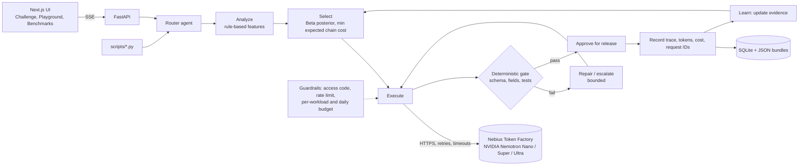

# EcoCompute AI

**Quality-aware, evidence-driven inference routing across NVIDIA Nemotron models on Nebius Token Factory.**

Most teams send every request to their largest model because they can't tell in advance which requests a smaller model would get right. EcoCompute makes that call per task. It starts each workload on the smallest Nemotron tier that is *likely* to pass an objective quality gate, checks the output deterministically, and escalates only when the check actually fails. Every decision, call, token and cent is recorded and shown, and the router learns from each outcome.

> Submitted to the Coding & Agentic Engineering track. License: MIT. Engineering audit: [docs/AUDIT.md](docs/AUDIT.md). Results: [docs/RESULTS.md](docs/RESULTS.md).

<!-- TODO before submission: hosted demo URL, YouTube link, and the real benchmark table below. -->

- **Live demo:** _TBD_
- **Demo video (< 3 min):** _TBD_

## What it does

| Step | What happens |
| --- | --- |
| **Analyze** | Rule-based features: category, complexity, expected output size. Every rule that fires is shown in the trace. |
| **Select** | Picks the start tier that minimises the expected cost of the whole escalation chain, subject to a quality target, a per-workload budget, latency, and a 50% first-attempt pass floor. Pass probabilities are Beta posteriors per (category, tier). |
| **Execute** | Calls Nebius Token Factory (OpenAI-compatible API). Records provider-reported prompt, completion and reasoning tokens, latency, request id and cost. Retries 429/5xx/timeouts with backoff. |
| **Evaluate** | Deterministic validators: JSON Schema, exact fields, exact/label/numeric/regex answers, required terms, word and bullet limits, and Python unit tests in a sandboxed subprocess. An optional model judge is labelled an estimate. |
| **Repair / Escalate** | One bounded repair on structural failures, then escalate to the next tier with a fresh prompt. |
| **Approve** | Model output is untrusted. An answer is approved for release only after the deterministic checks pass; a failing answer is never approved. |
| **Record / Learn** | Persists the full machine-readable trace and updates routing evidence. |

## Architecture



## Models and services actually used

| What | Detail | Verified? |
| --- | --- | --- |
| Nebius service | **Nebius Token Factory** chat completions (`https://api.tokenfactory.nebius.com/v1/`, OpenAI-compatible) and its `/models` catalog. No Nebius AI Cloud compute is used. | Client is unit-tested; a live call is verified with `scripts/verify_nebius.py` (see [RESULTS](docs/RESULTS.md) for status) |
| NVIDIA open models | Nemotron 3 Nano 30B-A3B (small), Nemotron 3 Super 120B-A12B (medium), Nemotron 3 Ultra 550B-A55B (large, the baseline) | IDs below are checked against the authenticated catalog by `verify_nebius.py`; override with `NEBIUS_MODEL_SMALL|MEDIUM|LARGE` if they differ |
| Everything else | Rule-based routing and deterministic validation run locally and make no model calls. The optional model judge is off by default and labelled an estimate. | — |

Model tiers (configurable):

| Tier | Default model | Active params |
| --- | --- | --- |
| small | `nvidia/NVIDIA-Nemotron-3-Nano-30B-A3B` | 3B |
| medium | `nvidia/nemotron-3-super-120b-a12b` | 12B |
| large (baseline) | `nvidia/Nemotron-3-Ultra-550b-a55b` | 55B |

## The EcoCompute Challenge (90-second demo)

Open **The Challenge** page and click **Run live** on a scenario. The same task goes down two lanes at once, both making genuine Nebius calls at temperature 0:

- **EcoCompute lane:** the routing policy picks a start tier, a deterministic validator checks the answer, and if (and only if) it fails, the router escalates and re-checks against the same requirement.
- **Baseline lane:** the same task and requirement on the fixed large model, with no escalation.

The page ticks off eight things a judge should see (requirement, smaller-model selection, validator rejection, escalation, re-check, full trace, baseline, comparison), then compares quality, latency, tokens and total cost, including routing and evaluation overhead (both $0 because routing is rule-based and validation is deterministic; their local compute time is measured from the trace). It states plainly whether optimisation helped, or what the tradeoff was.

Three scenarios: **Routine triage** (a small model should pass first time) and **Demanding extraction** (strict schema, time conversion and arithmetic; hard for a small model). Nothing forces a failure: if the small model passes the hard task, the page says so. **Safety drill** is the one deliberate exception, and it is labelled as such: the small model answers the routine task for real, then EcoCompute corrupts that answer on purpose (shown as `INJECTED` in the trace, the call log and the JSON). The gate must reject it, and the router escalates and re-checks against the same requirement. The drill makes no performance claim, its injected attempt never counts as routing evidence, and if the gate ever accepts the injected answer the run is flagged as a gate defect and nothing is released. Every run is stored and listed with provider request IDs and links to the raw JSON records (`/api/challenges/<id>`, `/api/workloads/<id>`). Failure handling is tested with deterministic fixtures in `backend/tests/test_challenge.py`, never in the live demo.

## Results

<!-- Fill from benchmarks/results/run-<id>-nebius.json after the real run. Never paste mock numbers here. -->

See [docs/RESULTS.md](docs/RESULTS.md) for what has been verified so far. _Pending: the held-out benchmark on real Nebius calls has not been run yet._ The table will report, for each condition on the 35 held-out EcoBench test tasks: pass rate with Wilson 95% CI, total cost, cost per success, tokens per task, mean latency and escalation rate, plus paired bootstrap 95% CIs for the difference versus always using the large model.

## The app

| Page | Purpose |
| --- | --- |
| The Challenge | Live two-lane demo: EcoCompute vs fixed baseline on the same task, with verdict and verifiable call log |
| Overview | Pass rate, cost per success, escalation rate, latest benchmark, where workloads finish |
| Playground | Presets or your own task, routing preview (free), live streamed trace, result |
| Router | Tier table, policy settings, evidence heatmap (prior vs observed vs posterior) |
| Benchmark Lab | Start runs, live progress, results with CIs, paired comparisons, per-category view, JSON export |
| Impact | A measured / B estimated (low-central-high) / C not observable |
| History | Every workload with its trace and attempts |
| Methodology | Equations, validators, benchmark design, impact assumptions and sources |
| Settings | API URL, demo access code, backend config, catalog diagnostics |

Anything produced by the offline mock provider is labelled **sample data** in the API (`sample_data: true`) and with a banner in the UI.

## Run locally

Requirements: Python 3.11+, Node 20+.

```bash
cp .env.example .env            # add NEBIUS_API_KEY; leave it empty to use the offline mock provider

# backend
cd backend
pip install -r requirements-dev.txt
python -m pytest -q             # 52 tests, offline
uvicorn app.main:app --reload --port 8000

# frontend (new terminal)
cd frontend
cp .env.example .env.local      # NEXT_PUBLIC_API_URL=http://localhost:8000
npm install
npm run dev                     # http://localhost:3000
```

Run the Challenge from the terminal (also shows up in the UI): `python scripts/run_challenge.py routine` or `demanding`.

Verify a real Nebius call and the configured model IDs:

```bash
python scripts/verify_nebius.py
```

Run the benchmark (same code path as the UI; total cost at listed prices is under $1):

```bash
# 1. calibration split: gathers routing evidence only
python scripts/run_benchmark.py --split calib --conditions fixed:small fixed:medium fixed:large
# 2. held-out test split
python scripts/run_benchmark.py --split test --conditions fixed:large adaptive adaptive_warm fixed:small
```

Results go to the SQLite DB (visible in the UI) and `benchmarks/results/run-<id>-<provider>.json`.

## Configuration

All configuration is environment variables; see [`.env.example`](.env.example). The important ones:

| Variable | Purpose |
| --- | --- |
| `NEBIUS_API_KEY` | Enables real inference. Without it the mock provider is used. |
| `NEBIUS_MODEL_SMALL/MEDIUM/LARGE` | Model IDs per tier. |
| `NEBIUS_PRICE_IN_*/OUT_*` | USD per 1M tokens; used for cost. Without prices, cost shows as unavailable and the router uses a relative cost proxy. |
| `ECOCOMPUTE_DEMO_ACCESS_CODE` | If set, paid endpoints require the `X-Access-Code` header. |
| `ECOCOMPUTE_DAILY_BUDGET_USD`, `ECOCOMPUTE_MAX_WORKLOAD_COST_USD`, `ECOCOMPUTE_BENCHMARK_MAX_CALLS`, `ECOCOMPUTE_RATE_LIMIT_PER_MINUTE` | Spend guardrails. |
| `ECOCOMPUTE_CORS_ORIGINS` | Comma-separated frontend origins. |
| `ECOCOMPUTE_ENABLE_CODE_EXECUTION` | Turns the sandboxed Python validator on or off. |

## Deploy

- **Backend:** `backend/Dockerfile` (build context = repo root). `render.yaml` is a ready Render Blueprint on the free plan (history resets when the instance restarts; add a disk on a paid plan to keep it); set `NEBIUS_API_KEY`, `ECOCOMPUTE_DEMO_ACCESS_CODE` and `ECOCOMPUTE_CORS_ORIGINS` in the dashboard.
- **Frontend:** Vercel, root directory `frontend`, env `NEXT_PUBLIC_API_URL=<backend URL>`.

## Repository layout

```
backend/        FastAPI app (router engine, policy, validators, providers, benchmark, impact estimator) + tests
frontend/       Next.js app
benchmarks/     EcoBench v1 dataset and exported results
scripts/        verify_nebius.py, run_challenge.py, run_benchmark.py
docs/           methodology, results, engineering audit, submission kit
DECISIONS.md    design decisions and trade-offs
```

## Honesty rules this project follows

- No result is reported from the mock provider.
- Costs come from provider-reported tokens × configured price; calls without usage are counted, not guessed.
- The only deliberately bad output is the labelled safety drill; no real model is ever steered to fail.
- Environmental figures are estimates (from FLOPs, not power measurements) with low/central/high bounds and listed assumptions, separated from what is measured and from what cannot be observed.
- Benchmark priors are heuristics and are shown as such; the warm condition uses calibration evidence only.

See [docs/methodology.md](docs/methodology.md) and [DECISIONS.md](DECISIONS.md).
